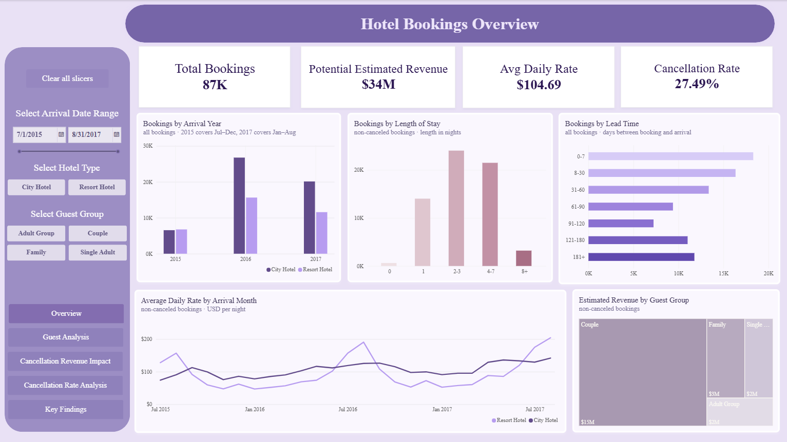
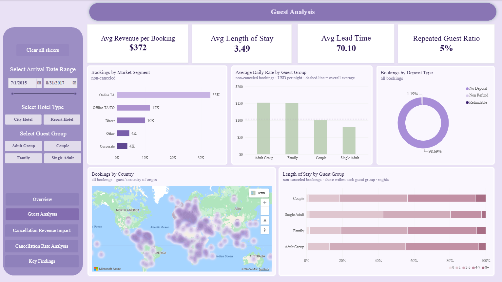
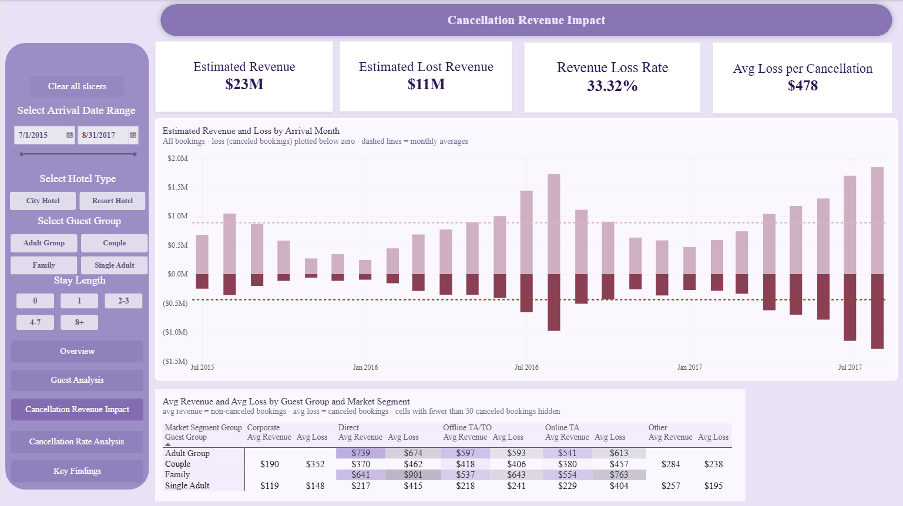
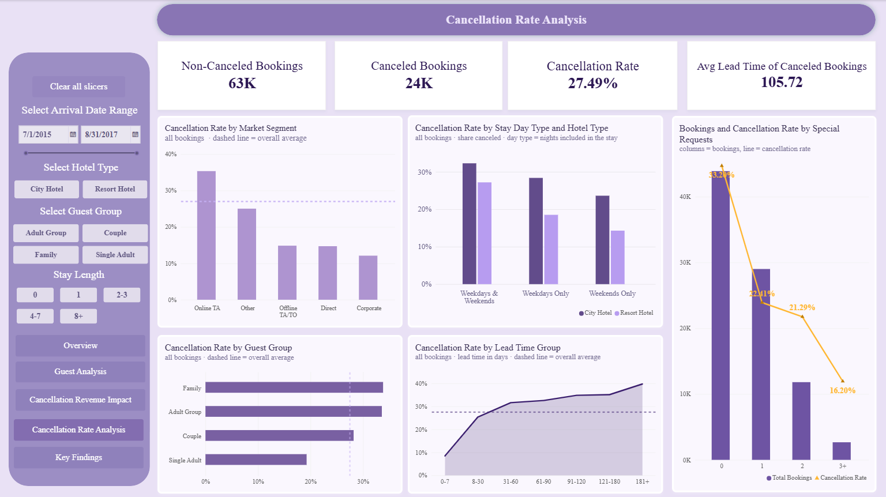
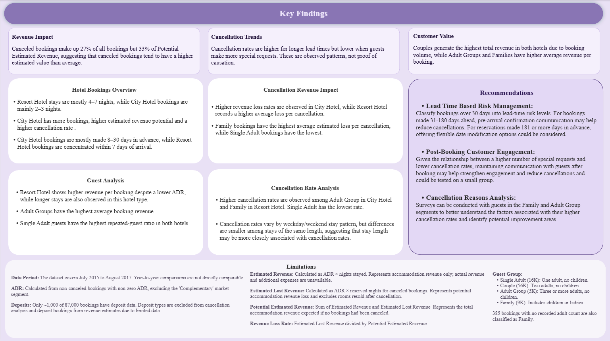

# HOTEL CANCELLATION REVENUE ANALYSIS 

## Project Overview
This project is a five-page Power BI report that examines hotel booking cancellations and their estimated impact on revenue.  The goal is to understand which guest groups and booking conditions are associated with higher cancellation rates, and how much potential accommodation revenue is lost to cancellations.  
The report moves from a general view of bookings and guest profiles to the financial impact of cancellations, then to the factors associated with cancellation rates such as lead time, stay length, market segment and special requests. Key findings, recommendations and data limitations are summarized on the final page. All findings are observed patterns in the data and should not be read as proof of causation.

## Power BI Project 
Hotel Bookings Overview

Guest Analysis 

Cancellation Revenue Impact 

Cancellation Rate Analysis

Key Findings

## Dataset Information 
This project uses the Hotel Booking Demand Dataset.

- Dataset: https://www.kaggle.com/datasets/jessemostipak/hotel-booking-demand
- License: CC BY 4.0 (Creative Commons Attribution 4.0 International)
- Original authors: Nuno Antonio, Ana Almeida, and Luis Nunes
- Dataset size: 119,390 records
- Period covered: July 2015 – August 2017
- Hotel types: City Hotel and Resort Hotel
